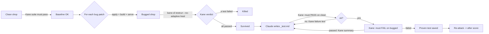

# Saboteur

**Find out which bugs your Kane tests would miss, then let Claude write the tests that catch them, proven by Kane.**

[](https://github.com/softalpha0/saboteur/actions/workflows/ci.yml)


▶️ **Demo video:** _TODO (YouTube link)_ · 📊 **Showcase report:** [`evidence/README.md`](evidence/README.md) · 🏁 Built for the [KaneCLI Online Hackathon](https://www.kaneclihack.sh/) (TestMu AI, Nov 2026)

> Before: **_TODO_/10** planted bugs caught by the starter suite → After: **_TODO_/10**. Numbers from a real run, see evidence.

---

## Contents

1. [The problem](#the-problem)
2. [What it does](#what-it-does)
3. [Try it](#try-it)
4. [How it works](#how-it-works)
5. [Guarantees](#guarantees)
6. [Verified evidence](#verified-evidence)
7. [Tech stack](#tech-stack)
8. [Run it yourself](#run-it-yourself)
9. [Testing](#testing)
10. [Project layout](#project-layout)
11. [Known limitations](#known-limitations)
12. [Build log](#build-log)
13. [Credits](#credits)

## The problem

Coding agents write our apps and our end-to-end tests now. A green suite tells you the app works today. It doesn't tell you whether those tests would notice tomorrow's bug. A browser test can click all the way through checkout and still pass when the total is wrong.

## What it does

1. **Plants bugs.** Ten small, realistic bugs (wrong total, dead "+" button, 1% instead of 10% discount, bad redirect…), one at a time, each as a real code patch.
2. **Lets Kane hunt.** Runs your Kane CLI suite against each broken build in real Chrome, with healing turned off so a broken page fails instead of being worked around.
3. **Scores the suite.** Killed = Kane caught it. Survived = it got through.
4. **Closes the gaps.** For each survivor, Claude writes a new `_test.md`. Kane runs it twice: it must **pass on the correct app** and **fail on the bugged app**. If not, Kane's own failure message goes back to Claude for another try (max 3).
5. **Reports.** Before/after score, per-bug table, Kane failure messages, links to every run.

- **Agent used:** Claude (Anthropic API) writes and revises tests. Built with Claude Code.
- **What Kane does:** every pass/fail verdict in Saboteur is a Kane verdict (`testrun run`, `testmd run`, `--no-adaptive-heal`).

## Try it

Judges: you already have Kane CLI access. This path needs **no Anthropic key**.

```bash
git clone https://github.com/softalpha0/saboteur && cd saboteur
pnpm i
npm i -g @testmuai/kane-cli
kane-cli login                 # then: kane-cli config project
pnpm saboteur doctor --replay  # Kane signed in, credits, Chrome, patches apply, app builds
pnpm saboteur run --replay     # uses the Claude-written tests we committed; Kane still proves them
```

Live loop (Claude writes new tests): copy `.env.example` to `.env`, set `ANTHROPIC_API_KEY` and `ANTHROPIC_MODEL`, then `pnpm saboteur run`.

## How it works



More diagrams (sequence, mutant state machine): [`docs/04-ARCHITECTURE.md`](docs/04-ARCHITECTURE.md).

## Guarantees

| Guarantee | How |
|---|---|
| A test is only added if Kane proves it | Accepted only on Kane exit 0 on clean **and** exit 1 on the bugged build |
| No healing around bugs | Bugged builds run with `--no-adaptive-heal` |
| The suite is valid before attacking | Baseline must pass on the clean build; any test authored during a bugged run invalidates that run |
| Product code is never changed | Bugs are applied to a temp copy; Saboteur only writes test files |
| Every number is traceable | Each verdict stores Kane's execution id, failure message and link |

## Verified evidence

See [`evidence/README.md`](evidence/README.md): per-bug Kane results, Test Manager links, closed-loop transcripts, launch posts. _TODO after showcase run._

## Tech stack

TypeScript · Node 20 · pnpm workspaces · Vite + React (demo shop) · **Kane CLI 0.10.x** · Anthropic SDK (Claude) · commander · Vitest · Biome

## Run it yourself

1. Node 20+, pnpm, Chrome on PATH.
2. `npm i -g @testmuai/kane-cli`, then `kane-cli login` and `kane-cli config project`.
3. `pnpm i`
4. `pnpm saboteur doctor` (checks Kane sign-in, credits, Chrome, app build)
5. `pnpm saboteur run` (or `--replay`)

Your own app: edit `saboteur.config.json` (build/serve commands, URL, tests dir, bug patches). See [`docs/05-MUTATIONS.md`](docs/05-MUTATIONS.md).

### Commands

| Command | What it does |
|---|---|
| `pnpm saboteur doctor [--replay]` | Kane installed and signed in, credits above `minCredits`, Chrome, suite found, Kane preflight (`testrun --dry-run`), every patch applies, app builds, port free, Claude key (live mode only) |
| `pnpm saboteur baseline` | Builds the clean app, runs every `_test.md` with healing on. Must exit 0. New tests get recorded here |
| `pnpm saboteur attack [--only M03] [--with-generated]` | For each bug: copy the app, `git apply`, build, serve on :4173, `kane-cli testrun run ... --no-adaptive-heal`, classify |
| `pnpm saboteur fill [--only M03]` | For each survivor of the last attack: Claude writes one `_test.md`, Kane must pass it on the clean build and fail it on the bugged build (max 3 tries) |
| `pnpm saboteur run [--replay] [--only ...]` | doctor, baseline, attack with the starter suite (before score), re-attack survivors with generated tests already in the repo, fill what still slips through (skipped with `--replay`), re-attack, write the report (after score) |
| `pnpm saboteur mutate --ai [--count 5] [--dry-run]` | Claude proposes new bugs for your app as small find/replace edits. Saboteur makes the patch itself and keeps a bug only if it applies, builds, changes the build output, and Kane confirms it is visible: Claude's check must pass on the bugged build and fail on the correct one. Kept bugs go to `mutations/ai/` and the manifest (`"source": "ai"`) |
| `pnpm saboteur report` | Re-render `reports/latest/report.md` and `report.html` from `report.json` |

Every report is written three ways: `report.json`, `report.md` and a static `report.html` (open it in a browser).

On GitHub: `.github/workflows/saboteur.yml` runs `saboteur attack` with real Kane on a pull request labelled `saboteur` (or by hand) and posts the report as a PR comment. It needs repo secrets `LT_USERNAME` and `LT_ACCESS_KEY`, and spends credits, so it never runs unless asked.

Logs for every run: `evidence/runs/<run-id>/` (Kane NDJSON, Kane stderr, build and serve logs, one `fill-<bug>.md` transcript per survivor).

## Testing

`pnpm test` (Vitest: Kane NDJSON parser, verdict rules, `_test.md` validator, prompts, report, every patch applies and builds, and the fill loop and `run --replay` end to end against real builds of the shop with a scripted stand-in for `kane-cli`, so CI spends no credits) · `pnpm biome check` · `pnpm -r typecheck`. Kane-backed checks: [`docs/09-TESTING.md`](docs/09-TESTING.md).

## Project layout

```
apps/shop/            demo shop + mutations/ (bug patches) + ROUTES.md
packages/cli          saboteur CLI
packages/kane         the only code that calls kane-cli
packages/agent        Claude prompts + _test.md validator
packages/mutator      apply patch, build, serve
packages/report       report.json + report.md
tests/kane/starter    hand-written Kane tests
tests/kane/generated  Claude-written, Kane-proven tests
docs/                 PRD, rules, Kane integration, architecture, plan
evidence/             real run results and links
```

## Known limitations

- A full attack takes a while: every bug is a fresh build plus a replay of the whole suite. _TODO: real timing._
- The demo catalog (M01 to M10) is hand-written. `mutate --ai` adds more for your own app; each kept bug costs two short Kane runs to prove it is visible.
- Bugs run one at a time. Running several in parallel would need one port per worker, and the `_test.md` files point at one URL.
- Kane runs cost credits; replays of recorded tests are much cheaper than authoring runs.

## Build log

[`BUILD_LOG.md`](BUILD_LOG.md)

## Credits

Built solo by softalpha0 for the KaneCLI Online Hackathon by [TestMu AI](https://www.testmuai.com/). Kane CLI docs: https://github.com/LambdaTest/kane-cli. MIT licence.
