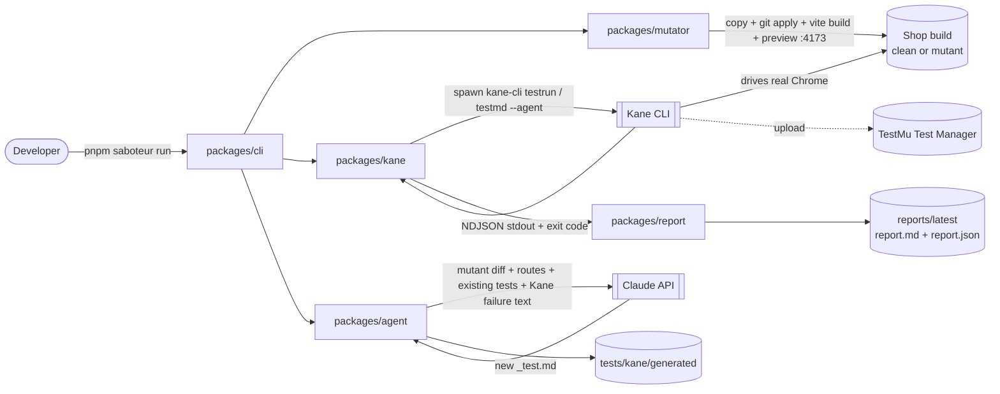
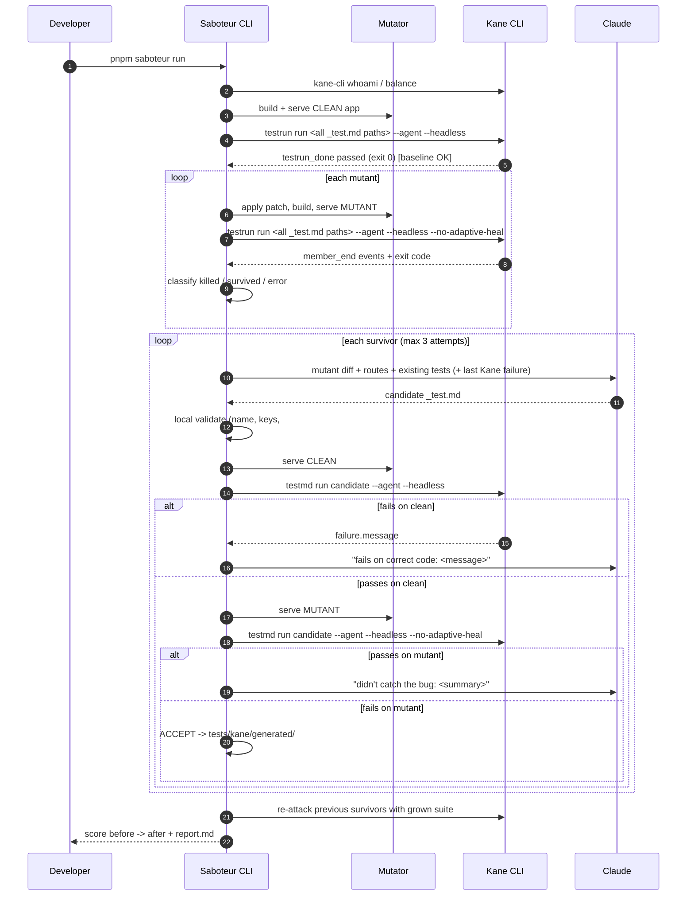
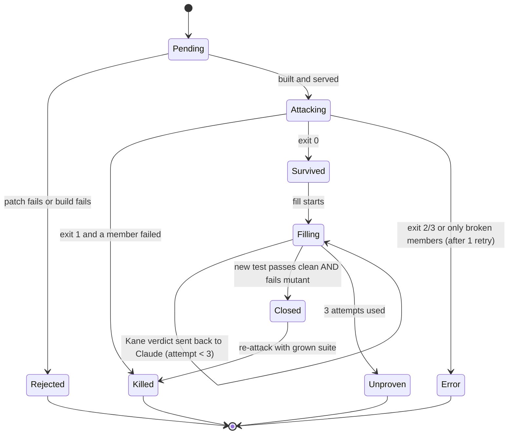

# 04 — Architecture

## 1. Repo layout

```
saboteur/
├── apps/
│   └── shop/                    # demo app (Vite + React + TS), served on :4173
│       ├── src/
│       └── mutations/           # *.patch + manifest.json  (05-MUTATIONS.md)
├── packages/
│   ├── cli/                     # `saboteur` CLI (commander): doctor, baseline, attack, fill, run, report
│   ├── kane/                    # ONLY place that spawns kane-cli; NDJSON parser; verdict rules
│   ├── agent/                   # Claude calls: write-test, (S4) propose-mutant; prompt files
│   ├── mutator/                 # copy app, git apply, build, serve, health-check, teardown
│   └── report/                  # report.json schema + report.md renderer
├── tests/
│   └── kane/
│       ├── starter/             # 4 hand-written _test.md (+ output-*/ recordings, committed)
│       └── generated/           # Claude-written, Kane-proven _test.md (+ output-*/)
├── docs/                        # 01–09 docs
├── evidence/                    # run logs, reports, links to evidence packs (no .evidence files)
├── reports/latest/              # report.md, report.json (gitignored except committed showcase run)
├── .github/workflows/ci.yml     # lint, typecheck, unit tests (no Kane credits in CI by default)
├── AGENTS.md  CLAUDE.md  README.md  BUILD_LOG.md
├── saboteur.config.json
├── .env.example
├── biome.json  tsconfig.base.json  pnpm-workspace.yaml  package.json
└── LICENSE (MIT)
```

## 2. Stack

| Layer | Choice | Why |
|---|---|---|
| Language | TypeScript (Node 20+) | Kane CLI is an npm package; one ecosystem |
| Monorepo | pnpm workspaces | Matches cadence repo standard |
| CLI | commander + picocolors (+ ink only if time) | Small, cross-platform |
| Demo app | Vite + React + TS, client-side state in `localStorage` | No backend → judges run it with zero setup |
| LLM | Anthropic TypeScript SDK `@anthropic-ai/sdk`, model from `ANTHROPIC_MODEL` | Claude is "the agent" in the submission |
| Lint/format | Biome | One tool, fast |
| Unit tests | Vitest | Parser + verdict rules + validator |
| Browser testing | **Kane CLI only** | Rule of the hackathon and the whole point |

## 3. System diagram



## 4. End-to-end sequence (`saboteur run`)



## 5. Mutant state machine



## 6. Package contracts

### `packages/kane`

```ts
type MemberResult = {
  file: string;                 // basename, e.g. "checkout_test.md"
  status: 'passed' | 'failed' | 'broken' | 'interrupted';
  durationS: number;
  sessionId?: string;
  logPath?: string;
  failure?: { message: string; stepIndex?: number };
};

type SuiteRun = {
  exitCode: 0 | 1 | 2 | 3 | number;
  executionId?: string;
  overallStatus?: 'passed' | 'failed' | 'cancelled';
  members: MemberResult[];      // from testrun_member_end + testrun_authored_member_end
  totals?: { tests: number; passed: number; failed: number; broken: number; skipped: number; authored: number };
  rawLogPath: string;           // evidence/runs/<id>/kane.ndjson
};

runSuite(opts: { testsDir: string; noHeal: boolean; parallel?: number }): Promise<SuiteRun>;
runTestFile(opts: { file: string; noHeal: boolean }): Promise<{ exitCode: number; overallStatus?: string; shareUrl?: string; sessionId?: string; rawLogPath: string }>;
balance(): Promise<string>;     // raw `kane-cli balance` output, shown in doctor
classifyMutant(run: SuiteRun): 'killed' | 'survived' | 'error' | 'invalid';
```

Field names come from `03-KANE-INTEGRATION.md` §3. Unknown event types are logged, never thrown on.

### `packages/mutator`

```ts
prepare(mutant?: Mutant): Promise<{ dir: string }>;   // copy + apply (if mutant) + build
serve(dir: string): Promise<{ stop(): Promise<void> }>; // vite preview :4173 --strictPort, waits for HTTP 200
```

### `packages/agent`

```ts
writeTest(input: {
  mutant: Mutant; diff: string; routes: string; existingTests: { file: string; body: string }[];
  previousAttempt?: { testBody: string; problem: 'fails-on-clean' | 'passes-on-mutant'; kaneText: string };
}): Promise<{ fileName: string; body: string }>;
```

### `report.json` (top level)

```json
{
  "runId": "2026-11-18T14-02-11Z",
  "kaneCliVersion": "0.10.3",
  "app": "apps/shop",
  "before": { "killed": 0, "survived": 0, "errors": 0 },
  "after":  { "killed": 0, "survived": 0, "errors": 0 },
  "mutants": [
    {
      "id": "M03", "title": "...", "verdictBefore": "survived", "verdictAfter": "killed",
      "caughtBy": "discount_save10_test.md",
      "kaneFailure": "Final verification failed: ...",
      "executionIds": ["..."],
      "fill": { "attempts": 2, "transcript": "evidence/runs/<id>/fill-M03.md", "accepted": true }
    }
  ]
}
```

Zeros above are placeholders for the schema only.

## 7. Config (`saboteur.config.json`, Should S1)

```json
{
  "app": {
    "dir": "apps/shop",
    "build": "pnpm vite build",
    "serve": "pnpm vite preview --port 4173 --strictPort",
    "url": "http://localhost:4173"
  },
  "tests": { "dir": "tests/kane", "generatedDir": "tests/kane/generated" },
  "mutations": { "manifest": "apps/shop/mutations/manifest.json" },
  "kane": { "parallel": 1, "suiteTimeoutMin": 15, "minCredits": 200 },
  "agent": { "maxAttempts": 3 }
}
```

`minCredits: 200` is our own safety floor, not a Kane number. Tune it after measuring baseline cost.
